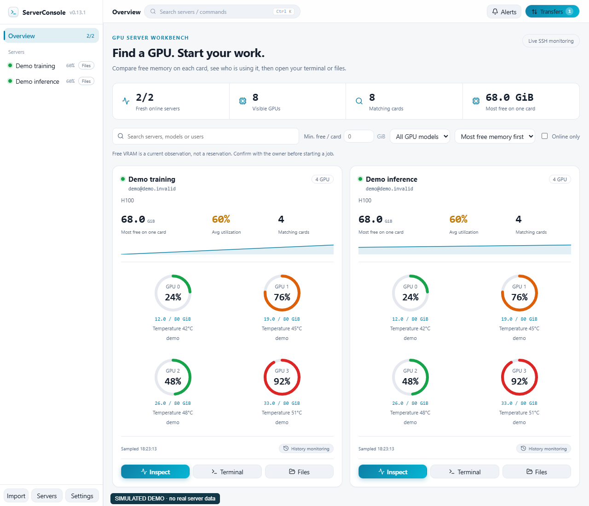

# ServerConsole

**找到显存够用的 GPU，看清占用用户，在一个桌面进入实验、终端与文件。**

[English](README.md) | [简体中文](README.zh-CN.md) | [繁體中文](README.zh-TW.md) | [日本語](README.ja.md) | [한국어](README.ko.md) | [Español](README.es.md) | [Français](README.fr.md) | [Deutsch](README.de.md) | [Русский](README.ru.md) | [Português (Brasil)](README.pt-BR.md)

[下载](https://github.com/Moguifeng-9119/server-console/releases/latest) · [Issues](https://github.com/Moguifeng-9119/server-console/issues) · [Changelog](CHANGELOG.md)


## 0.18.0 更新

- GPU、系统和进程分层采集已接入实际调度。未知指标保留未知状态，时间戳与断流间隔独立记录；主页保持每行四张 GPU 圆形仪表。

- 实验工作区保存服务器、目录、GPU、tmux、日志和服务信息；终端搜索、分屏布局和文件快捷入口保留操作上下文。

- 任务退出码与停止结果反映远端实际执行；终止前核对进程启动标识，防止 PID 复用误杀。离线状态进入告警规则和手机摘要。

- 历史支持 30 分钟、1 小时、12 小时、1 天、1 周，提供多卡对比、磁盘与网络指标、导出及任务/告警事件标记。原始数据保留 24 小时，分钟汇总保留 30 天并自动清理。

- 工作台提供任务卡、增量训练日志、GPU 可用提醒、告警规则、容器和服务隧道模板。Slurm 作业、详情和日志为只读功能，是否可用取决于主机环境。

- 文件同步先预览变更和排除规则，再确认执行。保存即上传区分排队、上传中、成功和失败，只有传输完成后才更新成功时间。

- 诊断与不含凭据的配置备份用于恢复和迁移。HTTPS Webhook 默认关闭，需主动配置；独立启动的无界面采集器可在桌面关闭后继续保存历史。

[0.18.0 release notes](docs/RELEASE-v0.18.0.md) · [Validation](docs/VALIDATION-0.18.0.md) · [Workspaces / tools guide](docs/WORKBENCH-GUIDE.md)

## 开始使用

在 Release 中选择实际附带的安装包。Windows 包未签名，SmartScreen 可能提示；使用该版本附带的 SHA-256 文件核对下载内容。macOS/Linux 以对应工作流与已上传附件的实际结果为准。

添加或导入 SSH 连接，核对主机指纹，再打开主页或工作台。GPU 监控需要远端 nvidia-smi，系统监控读取 Linux /proc。空闲显存是观测值，不代表预约或独占。

[Detailed usage and recovery](docs/USER-GUIDE.zh-CN.md) · [Security](SECURITY.md) · [Headless collector](docs/HEADLESS-MONITOR.md)

## 开发

```sh
git clone https://github.com/Moguifeng-9119/server-console.git
cd server-console
npm ci
npm run dev
```

浏览器页面是明确标注的模拟演示。真实 SSH、终端和 SFTP 需要 Electron 桌面进程。

```sh
npm run electron:dev
```

React 18 · TypeScript · Electron · Vite · ssh2 · SQLite. [package.json](package.json) · [Architecture](docs/ARCHITECTURE.md)

```sh
npm run lint
npm run typecheck
npm test
npm run smoke
npm run build
npm run test:ui
npm run test:workflow
```

## 验证与范围

准确命令、结果与待验项目见本版验证记录。两台真实 Linux SSH 主机已测试 GPU 流、三类采集通道、资源计数和退出码为 7 的专用任务。这些检查不代表生产集群、100GB 传输、真实 Slurm/MIG 或全部系统安装器均已验证。

[Current validation ledger](docs/VALIDATION-0.18.0.md) · [Packaging workflow](.github/workflows/package.yml) · [Benchmark methodology](docs/BENCHMARKS.md)

## 语言与指南

应用和 README 提供十种语言，机器辅助翻译仍需母语审校；远端输出保留原语言。下方截图为历史版本的模拟示例，不作为当前性能证据。



[Localization](docs/LOCALIZATION.md) · [Contributing](CONTRIBUTING.md) · [MIT](LICENSE)
